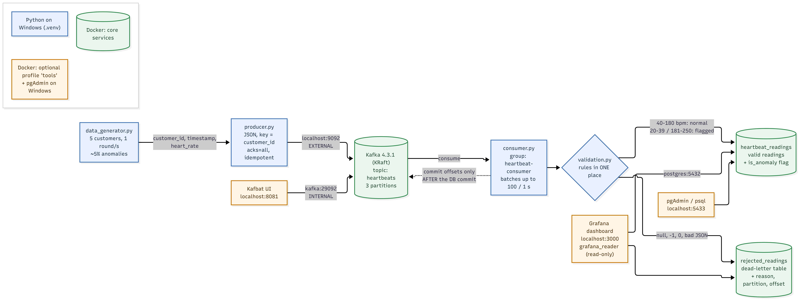

# Real-Time Customer Heart Beat Monitoring System

A real-time data pipeline that simulates heart-rate sensors for several customers, streams the
readings through **Apache Kafka**, validates them, and stores them in **PostgreSQL**, with an
optional **Grafana** dashboard and **Kafbat UI** for monitoring.



---

## Contents

1. [Tech stack and versions](#tech-stack-and-versions)
2. [Repository structure](#repository-structure)
3. [Quick start (Windows PowerShell)](#quick-start-windows-powershell)
4. [Optional: Grafana dashboard and Kafbat UI](#optional-grafana-dashboard-and-kafbat-ui)
5. [Configuration](#configuration)
6. [How it works](#how-it-works)
7. [Design decisions](#design-decisions)
8. [Testing](#testing)
9. [Results](#results)
10. [Problems solved during development](#problems-solved-during-development)
11. [Limitations and next steps](#limitations-and-next-steps)
12. [Deliverables](#deliverables)

---

## Tech stack and versions

| Component | Version | Runs in |
|---|---|---|
| Python | 3.14 | Windows (virtual environment `.venv`) |
| Apache Kafka (KRaft mode, no Zookeeper) | `apache/kafka:4.3.1` | Docker |
| PostgreSQL | `postgres:17` | Docker |
| Grafana OSS (optional) | `grafana/grafana:13.3.1` | Docker, profile `tools` |
| Kafbat UI (optional) | `ghcr.io/kafbat/kafka-ui:v1.5.0` | Docker, profile `tools` |
| Python libraries | pinned in `requirements.txt` | `confluent-kafka 2.16.2`, `psycopg2-binary 2.9.13`, `python-dotenv 1.2.4`, `pytest 9.2.0` |

---

## Repository structure

```
heartbeat-monitoring/
├── README.md
├── .gitignore
├── .env.example                  # settings template (copy to .env)
├── requirements.txt              # pinned Python libraries
├── docker-compose.yml            # Kafka + PostgreSQL (+ Grafana, Kafbat with --profile tools)
├── pytest.ini                    # test settings and the "integration" marker
├── src/
│   ├── config.py                 # loads all settings from .env (one place)
│   ├── data_generator.py         # synthetic heart-rate readings
│   ├── producer.py               # sends readings to Kafka
│   ├── validation.py             # the validation rules (one place)
│   └── consumer.py               # Kafka -> validation -> PostgreSQL
├── sql/
│   ├── 01_schema.sql             # tables, constraints, index
│   ├── 02_queries.sql            # example queries (historical data)
│   └── 03_grafana_reader.sql     # read-only user for Grafana
├── tests/
│   ├── test_validation.py        # 27 unit tests
│   ├── test_data_generator.py    # 14 unit tests
│   └── test_pipeline.py          # 2 end-to-end tests (real Kafka + PostgreSQL)
├── grafana/
│   ├── provisioning/datasources/postgres.yml   # data source as code
│   ├── provisioning/dashboards/dashboards.yml  # dashboard provider
│   └── dashboards/heartbeat.json               # the dashboard (8 panels)
└── docs/
    ├── architecture.mmd / architecture.png     # data flow diagram (Mermaid source + image)
    ├── sample_heartbeat_readings.csv           # sample output (20 rows)
    └── screenshots/                            # running system, tables, queries, dashboard
```

---

## Quick start (Windows PowerShell)

**Prerequisites:** Windows 10/11, [Docker Desktop](https://www.docker.com/products/docker-desktop/)
(running), Python 3.14, Git.

### 1. Clone and configure

```powershell
git clone https://github.com/<your-username>/heartbeat-monitoring.git
cd heartbeat-monitoring
Copy-Item .env.example .env
notepad .env        # set your own passwords (letters, digits and _ only)
```

> **Port 5433:** PostgreSQL is published on port **5433** so it does not clash with a
> PostgreSQL already installed on Windows (which uses 5432).

### 2. Python environment

```powershell
python -m venv .venv
.\.venv\Scripts\Activate.ps1
pip install -r requirements.txt
```

If activation is blocked: `Set-ExecutionPolicy -Scope CurrentUser RemoteSigned`.

### 3. Start Kafka and PostgreSQL

```powershell
docker compose up -d
docker compose ps          # wait until both show (healthy)
```

### 4. Create the database schema and the Kafka topic (first time only)

```powershell
docker exec hb-postgres psql -U heartbeat_user -d heartbeat_db -v ON_ERROR_STOP=1 -f /sql/01_schema.sql
docker exec hb-kafka /opt/kafka/bin/kafka-topics.sh --bootstrap-server kafka:29092 --create --topic heartbeats --partitions 3 --replication-factor 1
```

### 5. Run the pipeline (two PowerShell windows, both with `.venv` active)

```powershell
# Window A - consumer (start first)
python -m src.consumer

# Window B - producer
python -m src.producer                       # forever, 1 round per second (Ctrl + C to stop)
python -m src.producer --rounds 10           # or: 10 rounds, then stop
python -m src.producer --anomaly-rate 0.2    # or: more anomalies
python -m src.producer --help                # all options
```

Stop the **producer first**, wait a few seconds, then stop the consumer. Both shut down cleanly
on Ctrl + C and print a summary.

### 6. Query the stored data

```powershell
docker exec -e PAGER=cat hb-postgres psql -U heartbeat_user -d heartbeat_db -f /sql/02_queries.sql
```

### 7. Run the tests

```powershell
python -m pytest -m "not integration"    # 41 unit tests, no Docker needed
python -m pytest -m integration          # 2 end-to-end tests (consumer must be running)
python -m pytest                         # all 43
```

---

## Optional: Grafana dashboard and Kafbat UI

```powershell
# 1. Read-only database user for Grafana (password taken from .env)
$pw = ((Get-Content .env | Select-String '^GRAFANA_DB_PASSWORD=').Line -split '=', 2)[1]
docker exec hb-postgres psql -U heartbeat_user -d heartbeat_db -v ON_ERROR_STOP=1 -v reader_password=$pw -f /sql/03_grafana_reader.sql

# 2. Start the optional tools
docker compose --profile tools up -d
```

| Tool | URL | Login |
|---|---|---|
| Grafana dashboard | http://localhost:3000/d/heartbeat-monitoring | `admin` / `GRAFANA_ADMIN_PASSWORD` from `.env` |
| Kafbat UI | http://localhost:8081 | none (local use only) |

The Grafana data source and the 8-panel dashboard are **provisioned from files** in `grafana/`,
so they appear automatically with no manual setup.

---

## Configuration

All settings live in `.env` (never committed). `src/config.py` reads them once and fails fast
with a clear message if one is missing.

| Setting | Default | Used by |
|---|---|---|
| `KAFKA_BOOTSTRAP_SERVERS` | `localhost:9092` | producer, consumer, tests |
| `KAFKA_TOPIC` | `heartbeats` | producer, consumer |
| `KAFKA_GROUP_ID` | `heartbeat-consumer` | consumer |
| `POSTGRES_HOST` / `POSTGRES_PORT` | `localhost` / `5433` | consumer, tests |
| `POSTGRES_DB` / `POSTGRES_USER` / `POSTGRES_PASSWORD` | `heartbeat_db` / `heartbeat_user` / *(yours)* | consumer, Docker |
| `GRAFANA_DB_PASSWORD` | *(yours)* | read-only Grafana user |
| `GRAFANA_ADMIN_PASSWORD` | *(yours)* | Grafana login |

---

## How it works

1. **`data_generator.py`** creates readings for 5 customers, each with a personal resting
   baseline (62-80 bpm) plus Gaussian noise (sd 5 bpm). About 5% of readings are deliberately
   abnormal: too high (185-220), too low (20-35) or corrupt (`null`, `-1`, `0`).
2. **`producer.py`** sends each reading as JSON to the `heartbeats` topic, with
   `customer_id` as the message key.
3. **Kafka** stores the messages in 3 partitions. The key makes each customer always use the
   same partition, so a customer's readings stay in order.
4. **`consumer.py`** reads batches (up to 100 messages or 1 second), runs every message through
   **`validation.py`**, and writes it to the right table in **one transaction per batch**.
5. **PostgreSQL** stores valid readings in `heartbeat_readings` and rejected messages in
   `rejected_readings`.

### Validation rules (`src/validation.py`)

| Reading | Example | Result |
|---|---|---|
| Normal (40-180 bpm) | 72 | stored in `heartbeat_readings`, `is_anomaly = false` |
| Abnormal but possible (20-39 or 181-250 bpm) | 27, 204 | stored, `is_anomaly = true` (could be a real emergency, so it is never thrown away) |
| Impossible or corrupt | `null`, `-1`, `0`, `72.5`, `"72"`, `true`, missing field, no time zone, not JSON | stored in `rejected_readings` with the reason and its Kafka partition/offset |

### Database schema (`sql/01_schema.sql`)

| Table | Key columns | Rules |
|---|---|---|
| `heartbeat_readings` | `customer_id`, `recorded_at TIMESTAMPTZ`, `heart_rate SMALLINT`, `is_anomaly`, `ingested_at` | `CHECK (heart_rate BETWEEN 20 AND 250)`, `UNIQUE (customer_id, recorded_at)`, index on `recorded_at` |
| `rejected_readings` | `raw_message TEXT`, `reason`, `kafka_partition`, `kafka_offset`, `rejected_at` | `UNIQUE (kafka_partition, kafka_offset)` |

---

## Design decisions

| Decision | Why |
|---|---|
| **KRaft instead of Zookeeper** | The brief mentions Zookeeper, but Apache Kafka 4.0 (March 2025) removed it. KRaft is the current supported architecture and needs one container fewer. The Python code is the same either way. |
| **Two Kafka listeners** | `localhost:9092` (EXTERNAL) for Python on Windows; `kafka:29092` (INTERNAL) for containers such as Kafbat UI. |
| **Auto-create topics off** | A typo in a topic name fails loudly instead of silently creating an empty topic. |
| **`customer_id` as the message key** | Same customer, same partition, so each customer's readings stay in order. |
| **At-least-once + idempotent writes** | The consumer commits to PostgreSQL **first**, then commits the Kafka offset. A crash in between causes a re-delivery, and `INSERT ... ON CONFLICT DO NOTHING` skips the duplicate. Nothing is lost and nothing is stored twice. |
| **Store anomalies, reject the impossible** | A reading of 204 bpm may be a real emergency, so it is kept and flagged. `null` or `-1` is not a heart rate, so it would distort averages. |
| **Dead-letter table** | Rejected messages are kept with their reason and Kafka position, instead of being silently dropped. |
| **Rules and settings in one place** | Thresholds only in `validation.py`, settings only in `config.py`, so there is no duplicated logic. |
| **`TIMESTAMPTZ`, UTC timestamps** | One unambiguous moment in time, shown in any time zone. |
| **Batches of 100 / 1 s** | Fewer database round trips. Trade-off: about 0.5-1 s of extra latency at low traffic. Lowering `POLL_TIMEOUT_SECONDS` reduces latency. |
| **Database outage handling** | The consumer keeps the current batch, retries with exponential backoff (2, 4, 8 ... 30 s) and resumes without data loss. |
| **Read-only Grafana user** | `grafana_reader` has SELECT only, read-only sessions and a 10 s statement timeout. Least privilege. |
| **Optional tools behind a Compose profile** | `docker compose up -d` starts only the core pipeline. `--profile tools` adds Grafana and Kafbat. |
| **Infrastructure and dashboards as code** | Schema, data source and dashboard are files in Git, so a fresh clone reproduces everything. |

---

## Testing

| Suite | Tests | Needs Docker | Covers |
|---|---|---|---|
| `test_validation.py` | 27 | no | every boundary (20, 39, 40, 180, 181, 250) and every reject reason |
| `test_data_generator.py` | 14 | no | fields and types, realism per customer, anomaly rates (fixed random seed) |
| `test_pipeline.py` | 2 | yes + running consumer | 6 kinds of message through real Kafka and PostgreSQL; duplicates stored once |

All **43 tests pass**. The tests were also checked by breaking the code on purpose
(for example changing `<=` to `<` in the normal-range check makes 2 tests fail).

---

## Results

**Clean end-to-end run** (about 2 minutes, default 5% anomaly rate):

| Metric | Value |
|---|---|
| Messages in Kafka (3 partitions: 278 + 139 + 278) | **695** |
| Stored in `heartbeat_readings` | **685** (667 normal + 18 flagged anomalies) |
| Stored in `rejected_readings` | **10** (`-1` x5, `0` x3, missing x2) |
| Duplicates | **0** |
| Consumer lag after the run | **0** on every partition |
| Average / maximum pipeline delay (sensor to database) | **575 ms** / 1,099 ms |

Kafka total = stored + rejected (695 = 685 + 10): every message is accounted for exactly once.
The 18 : 10 split of flagged to rejected matches the generator's design (2 of the 3 anomaly kinds
are stored). Hourly averages per customer match the generator baselines (for example CUST_001
about 62 bpm, CUST_004 about 80 bpm).

**Index on `recorded_at`** (200,000 rows, 5-minute window = 300 rows; measured in a test
environment during development):

| | Without index | With index |
|---|---|---|
| Plan | Parallel Seq Scan (199,700 rows removed by filter) | Index Scan |
| Execution time | 13.9 ms | 0.11 ms |

**Resilience checks performed:** replaying the whole topic (offsets reset to the start) stored
**no** extra rows; stopping PostgreSQL mid-stream lost **no** messages (the consumer retried and
caught up).

Screenshots of the running system, tables, queries and dashboard are in `docs/screenshots/`.
A sample of stored rows is in `docs/sample_heartbeat_readings.csv`.

---

## Problems solved during development

| Problem | Diagnosis | Fix |
|---|---|---|
| `password authentication failed` from Python | Port 5432 reached a PostgreSQL installed on Windows, not the Docker one | Published Docker PostgreSQL on **5433** |
| Port mapping edited on the wrong side (`5433:5433`) | Running container still showed `5433->5432`; the file did not | Container side must stay `5432` (`"${POSTGRES_PORT}:5432"`) |
| Pasted SQL produced `sh: Syntax error` and `Examine:` | psql had opened its pager (`less`), which read the keystrokes | Start psql with `-e PAGER=cat`, or `\pset pager off` |
| 200,010 rows before going live | Test data from earlier steps had not been cleaned up | Traced each group to its step, then `TRUNCATE ... RESTART IDENTITY` |
| Grafana export was not the classic format | Grafana 13 exports dashboards in the v2 schema | Kept v2 (supported by file provisioning in 13.1.1+), set `metadata.name` for a stable URL |
| Provisioned dashboard did not appear, no error shown | Container, mounts and JSON were fine, but the provider file was in the `datasources` folder | Moved it to `provisioning/dashboards/` |

---

## Limitations and next steps

- **Single Kafka broker, replication factor 1** - fine locally; production would use 3 brokers.
- **Test messages remain in Kafka** - if consumer offsets are rewound, old `TEST_` rows can be
  re-stored; remove them with
  `DELETE FROM heartbeat_readings WHERE customer_id LIKE 'TEST_%'` (and the same for `rejected_readings`).
- **No authentication on Kafbat UI**, and plain-text connections - local use only.
- **Scaling ideas:** a `customers` table with a foreign key; partitioning or TimescaleDB for very
  large tables; a BRIN index on `recorded_at` for huge append-only data; Grafana alerts on anomalies.

---

## Deliverables

| Deliverable | Where |
|---|---|
| Python scripts: data generator, Kafka producer, consumer | `src/data_generator.py`, `src/producer.py`, `src/consumer.py` (+ `src/validation.py`, `src/config.py`) |
| SQL file to create the database schema | `sql/01_schema.sql` (+ `sql/02_queries.sql`, `sql/03_grafana_reader.sql`) |
| Docker Compose file | `docker-compose.yml` |
| README with setup guide and documentation | `README.md` |
| Data flow diagram | `docs/architecture.png` (source: `docs/architecture.mmd`) |
| Sample data outputs / screenshots | `docs/sample_heartbeat_readings.csv`, `docs/screenshots/` |
| Test scripts | `tests/` (43 tests) |
| (Optional) Dashboard | `grafana/` (provisioned Grafana dashboard) + `docs/screenshots/10_grafana_dashboard.png` |